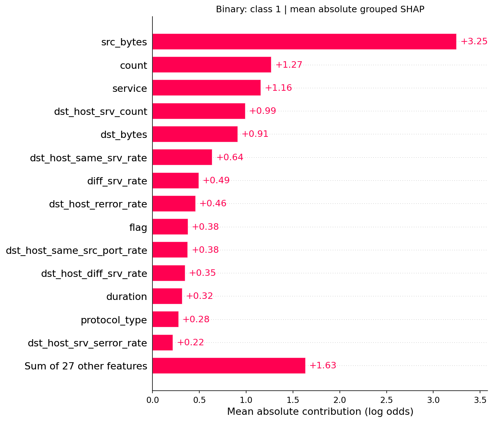
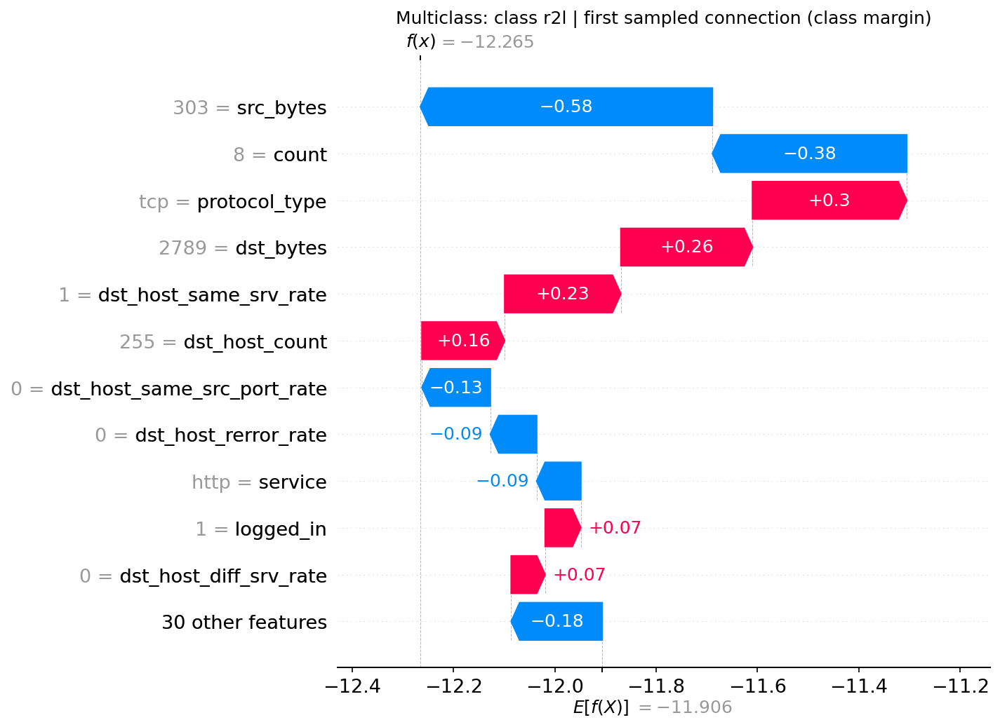

# SHAP Verification Check

The local check reviewed on 22 November 2026 used the exact binary and multiclass
LightGBM models from the existing completed v3 study. Neither was refitted or
replaced. The original NSL-KDD edition and default demo remain unchanged.

```bash
python -m pip install -r requirements-explainability.txt
python -B scripts/explain_models.py --trust-local-models \
  --output-dir runs/explanations_v1_verified
```

Only use the trust flag for your own trusted model files. The output directory
must be new; the recorded run is write-once.

## Results

The background used 64 training rows (seed 42); explanations used 32 historical
test rows (seed 43). Sampling was uniform without replacement, not selected by
labels, model errors, or interesting-looking plots. All 33 artifact hashes passed
verification. Both tasks' sampled probabilities and decisions matched their
frozen v3 prediction tables exactly after round-trip CSV loading.

| Task | Explained output | Maximum reconstruction error | Model warnings |
|---|---|---:|---|
| Binary | Class 1 log-odds | 1.507e-7 | None |
| Multiclass | Per-class raw margins | 1.930e-7 | None |

Reconstruction was independently checked against model outputs for both encoded
and grouped features, at `atol=1e-5`, `rtol=1e-5`. These are numerical consistency
checks, not performance improvements or proof of causal relevance.

The full suite passed 150 local tests. Coverage includes supported explainer
families, class order, background provenance, unseen categories, contribution
aggregation, bounded prediction parallelism, artifact corruption/path checks,
refusal to refit, failed exports, and existing-figure preservation. The figure
regression was verified to fail before the isolation fix and pass afterward.

## Example Figures

These are direct exports from the verified run. They contain no application
screenshots or cursor overlays. The complete local package includes separate
global and local plots for every explained output.

### Binary Global Importance



The ranking describes this sample/background/model combination. Each categorical
feature first sums its signed encoding-level contributions, then global
importance takes the mean absolute grouped value. The final displayed bar
aggregates omitted features. Its magnitude is not a probability or attack rate.

### Local R2L Class Explanation



This explains one model score, not an asserted correct R2L diagnosis. Red/blue
contributions move the selected class margin up/down relative to the background.
A multiclass margin is not a class probability; probabilities use the joint
softmax of all class margins. Inspecting the R2L score does not imply that this
connection was selected because it was R2L or that the model predicted R2L.

See the [full protocol and limitations](explainability.md), including independent
masking of correlated/one-hot features, sample dependence, and the distinction
between grouped encoding contributions and group/Owen SHAP values.

## Provenance

Environment: Python 3.12.13, SHAP 0.54.1, matplotlib 3.10.9, LightGBM 4.7.0,
NumPy 2.4.6, pandas 3.0.3, SciPy 1.17.1, scikit-learn 1.9.0, joblib 1.5.3,
threadpoolctl 3.6.0.

```text
Source study manifest SHA-256:
63a122eb80137291ab4a56605f022ea1165af6509cc8d5d866b6ca2d066a95c6

Verified explanation manifest SHA-256:
a9b397c389b9f6b9a268ed04a42096fff86b8405b6609c20790db40be657efdb
```

The ignored local export contains sampled source positions, contribution arrays,
predictions, diagnostics, hashes, exact top-level dependency versions, and archived
implementation. This note and its two illustrations do not make the full model
bundle available to a fresh checkout. Dashboard integration, newer-dataset
training, package distribution, and hosted deployment remain separate work.
